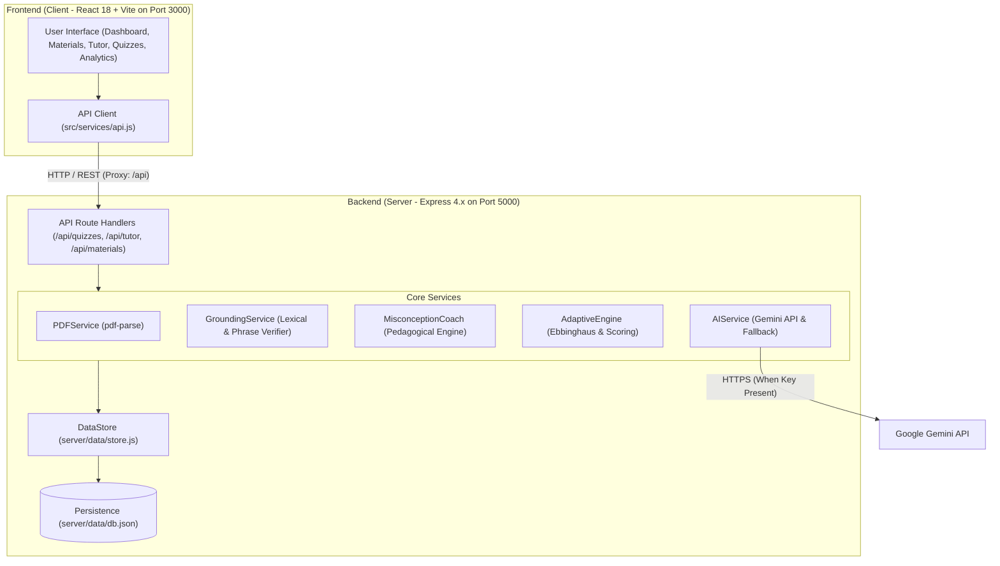

# EduPilot AI — Complete Project & Architecture Guide

Welcome to the comprehensive, beginner-friendly guide for **EduPilot AI**. This document is designed to help you thoroughly understand every component, service, algorithm, and workflow in the codebase so you can confidently explain and defend your project to college tutors, professors, and hackathon judges.

---

## Table of Contents
1. [Project Overview](#1-project-overview)
2. [Technology Stack](#2-technology-stack)
3. [System Architecture](#3-system-architecture)
4. [Major Feature Breakdown](#4-major-feature-breakdown)
5. [Core Technical Workflows](#5-core-technical-workflows)
6. [Code Walkthrough & Request Tracing](#6-code-walkthrough--request-tracing)
7. [API Endpoints Reference](#7-api-endpoints-reference)
8. [Glossary of Technical Terms](#8-glossary-of-technical-terms)
9. [Tutor & Judge Presentation Script](#9-tutor--judge-presentation-script)
10. [25 Likely Tutor Questions & Model Answers](#10-25-likely-tutor-questions--model-answers)

---

## 1. Project Overview

### What is EduPilot AI?
EduPilot AI is a full-stack, AI-powered personalized learning platform tailored specifically for Computer Science students. It bridges the gap between passive course lectures and deep conceptual mastery by turning lecture slides and notes into an adaptive learning ecosystem.

### The Problem It Solves
1. **Passive Learning Illusion**: Students often re-read textbooks or watch lecture videos believing they understand concepts, only to fail technical coding interviews and exams because they never actively tested their mental models.
2. **AI Hallucinations**: Generic AI chatbots (like ChatGPT) frequently fabricate definitions, cite non-existent textbook pages, or give convincing but completely incorrect explanations on algorithmic edge cases.
3. **No Root-Cause Error Analysis**: Traditional quiz tools merely tell students *"Option B is wrong, Option A is right"*, without explaining *why* the student thought Option B was correct or uncovering the underlying misconception.
4. **Unrealistic Study Schedules**: Study tools create infinite to-do lists that ignore how many hours a student actually has each day, leading to burnout.

### Objectives and Target Users
- **Target Users**: Undergraduate Computer Science and Engineering students preparing for coursework exams, midterms, and technical interviews.
- **Objectives**:
  - Ingest syllabus slide decks and extract core conceptual invariants.
  - Deliver 100% source-grounded answers with genuine, verifiable page numbers.
  - Provide an automated **Misconception Coach** that diagnoses student cognitive errors without making dogmatic claims about the student's mind.
  - Dynamically schedule revision based on Ebbinghaus forgetting curves, strictly constrained to daily available study hours.
  - Empirically measure pre-revision vs post-revision learning gains.

### Key Differentiators (Why EduPilot AI is Unique)
| Conventional Tool | EduPilot AI |
| :--- | :--- |
| Answers queries using ungrounded public web data. | Strictly grounds answers in uploaded course slides with verified page citations. |
| Hallucinates citations when evidence is missing. | Transparently labels answers as `[INSUFFICIENT EVIDENCE]` and falls back cleanly. |
| Binary right/wrong quiz feedback. | Pedagogical **Misconception Coach** that formulates cognitive hypotheses and immediate follow-up retests. |
| Arbitrary task checklists. | Time-bounded spaced repetition engine that never exceeds the student's daily study limit. |

---

## 2. Technology Stack

EduPilot AI is built as a modular client-server web application using modern JavaScript.

### Frontend
- **React 18 (`react`, `react-dom`)**: A component-based JavaScript library for building fast, declarative user interfaces.
- **Vite 5 (`vite`, `@vitejs/plugin-react`)**: A lightning-fast next-generation frontend build tool and development server using native ES modules.
- **Tailwind CSS (`tailwindcss`, `autoprefixer`, `postcss`)**: A utility-first CSS framework for responsive UI styling with modern dark/light mode support.
- **Lucide React (`lucide-react`)**: A clean, consistent icon library providing crisp vector icons for navigation, alerts, and learning tools.
- **Recharts (`recharts`)**: A composable charting library built on React components and SVG, used to visualize weekly study hours, retention curves, domain mastery, and pre/post delta gains.

### Backend
- **Node.js (ES Modules `type: "module"`)**: Server-side JavaScript runtime environment.
- **Express 4.x (`express`)**: A minimal and flexible web application framework providing robust routing and middleware.
- **CORS (`cors`)**: Middleware allowing secure cross-origin requests between the Vite dev server (`port 3000`) and the Express server (`port 5000`).
- **Multer (`multer`)**: Middleware for handling `multipart/form-data`, used to safely accept uploaded PDF files in memory without saving raw files to disk before validation.
- **PDFParse (`pdf-parse`)**: A reliable server-side PDF text extraction library that parses binary PDF streams and extracts individual page texts and page counts.
- **Dotenv (`dotenv`)**: Loads environment variables from `.env` into `process.env`.

### Artificial Intelligence & Resilience
- **Google Gemini API (`@google/genai` / HTTP REST)**: Generates adaptive follow-up quiz questions and tutor dialogues when an API key is present.
- **Deterministic Educational Fallback Catalog**: When API keys are missing or network calls fail, EduPilot executes comprehensive deterministic CS invariant templates labeled transparently as `[DEMO EXPLANATION]`, preventing runtime crashes during live demonstrations.

### Data Storage & Persistence
- **Local JSON Database (`server/data/store.js` -> `server/data/db.json`)**: An atomic, file-backed data store that serializes learning materials, quiz attempts, study tasks, and topic telemetry to disk. It requires zero complex database configuration, runs instantly anywhere, and survives server restarts.

---

## 3. System Architecture

The architecture separates presentation, API orchestration, algorithmic evaluation, and persistent storage:



### Information Flow: From User Click to Screen
1. **User Action**: The student uploads a slide deck or submits an answer.
2. **API Dispatch**: `src/services/api.js` sends an HTTP `POST` request to `/api/...`.
3. **Routing**: `server/index.js` routes the request to the matching controller in `server/routes/`.
4. **Algorithmic Processing**:
   - For PDFs: `PDFService.js` extracts raw text and divides it into page-stamped semantic passages.
   - For Questions: `GroundingService.js` compares query terms against document passages to verify relevance.
   - For Errors: `MisconceptionCoach.js` analyzes the incorrect choice and produces a hypothesis.
5. **State Mutation**: `store.js` records the attempt or topic telemetry and flushes updates to `server/data/db.json`.
6. **Response & Render**: The server returns JSON; React updates component state and renders clean UI feedback with zero page reloads.

---

## 4. Major Feature Breakdown

### 1. Overview Dashboard
- **What the student does**: Views their current study streak, upcoming tasks, daily learning goals, weekly activity bar chart, and curriculum mastery.
- **Behind the scenes**: Loads data via `ApiService.getProgress()` and `ApiService.getStudyPlan()`.
- **Key Files**:
  - Frontend: `src/components/dashboard/WelcomeBanner.jsx`, `KpiCard.jsx`, `WeeklyActivityChart.jsx`, `TopicMasterySection.jsx`, `StudyPlanWidget.jsx`, `RecentActivityWidget.jsx`.
- **Result**: Immediate high-level visibility of academic velocity and pending review items.

### 2. Course Materials & PDF Uploads
- **What the student does**: Drags and drops lecture slides or textbook chapters (PDF, up to 10MB).
- **Behind the scenes**: Multer receives the file in memory; `PDFService.js` validates MIME type and size, invokes `pdf-parse`, separates the text into distinct pages, and generates semantic passages.
- **Key Files**:
  - Frontend: `src/components/materials/LearningMaterialsPage.jsx`.
  - Backend: `server/routes/materials.js`, `server/services/pdfService.js`.
- **Result**: The document appears in the library as "Indexed" with extracted concept tags, page count, and action buttons (`Generate Quiz`, `Ask AI Tutor`, `Study Guide`).

### 3. AI Tutor with Source Grounding
- **What the student does**: Selects an uploaded course document and asks any question (or asks general CS questions).
- **Behind the scenes**: `GroundingService.js` tokenizes the query and searches the document passages. If genuine substantive concept matches exist, it extracts the exact page number and passage excerpt.
- **Key Files**:
  - Frontend: `src/components/tutor/AiTutorPage.jsx`.
  - Backend: `server/routes/tutor.js`, `server/services/groundingService.js`, `server/services/aiService.js`.
- **Result**: The tutor responds with status pills (`[SOURCE-GROUNDED • PAGE X]` or `[GENERAL KNOWLEDGE]`) and an expandable **Verbatim Document Excerpt** card showing the exact slide text.

### 4. Practice Quizzes & Answer Evaluation
- **What the student does**: Takes a targeted multiple-choice assessment with a live countdown timer.
- **Behind the scenes**: When the student validates an answer, the choice is evaluated immediately. On completion, the entire set is submitted to `POST /api/quizzes/:id/submit`, which records the score, updates topic mastery, and calculates pre-vs-post improvement.
- **Key Files**:
  - Frontend: `src/components/practice/PracticeQuizzesPage.jsx`, `src/components/practice/QuizRunner.jsx`.
  - Backend: `server/routes/quizzes.js`, `server/services/adaptiveEngine.js`.
- **Result**: Complete review breakdown with explanations, mastery percentage, and XP rewards.

### 5. Misconception Coach (Integrated in Quiz Runner)
- **What the student does**: Submits an incorrect answer during a quiz.
- **Behind the scenes**: Automatically triggers `POST /api/quizzes/misconception/diagnose`. The backend identifies the underlying concept, formulates a pedagogical hypothesis explaining why the choice was tempting but incorrect, checks the course slides for evidence, and provides an immediate follow-up probe.
- **Key Files**:
  - Frontend: `src/components/practice/QuizRunner.jsx`.
  - Backend: `server/routes/quizzes.js`, `server/services/misconceptionCoach.js`.
- **Result**: An educational feedback card appears with:
  1. *Pedagogical Diagnosis Hypothesis*.
  2. *Why Your Choice Was Incorrect* vs *Why Correct Invariant Holds*.
  3. *Verified Document Citation* (if present in slides).
  4. *Targeted Follow-Up Invariant Probe* that can be submitted and verified by the server immediately.

### 6. AI Study Planner
- **What the student does**: Views scheduled study sessions, clicks checkboxes to toggle completion, or clicks "AI Re-balance" to optimize their schedule.
- **Behind the scenes**: `AdaptiveEngine.generateStudyPlan()` sorts weak topics by lowest accuracy and oldest decay, allocating minutes without ever exceeding the student's daily study hours (e.g. 3.5 hrs).
- **Key Files**:
  - Frontend: `src/components/planner/StudyPlannerPage.jsx`, `AddTaskModal.jsx`.
  - Backend: `server/routes/studyPlan.js`, `server/services/adaptiveEngine.js`.
- **Result**: A structured daily queue that adapts dynamically as quiz scores change.

### 7. Progress Analytics & Retention Telemetry
- **What the student does**: Reviews long-term memory decay curves, subject mastery distributions, and pre vs post revision score deltas.
- **Behind the scenes**: Reads attempt records from `store.js` and pairs sequential attempts on the same topic to measure knowledge gain.
- **Key Files**:
  - Frontend: `src/components/analytics/ProgressAnalyticsPage.jsx`.
  - Backend: `server/routes/progress.js`, `server/services/adaptiveEngine.js`.
- **Result**: Empirical proof of learning gains (e.g. *"Attempt 1: 58% -> Attempt 2: 85% (+27% Gain)"*).

### 8. My Learning & Interactive Flashcards
- **What the student does**: Explores enrolled university courses, opens AI revision decks, and tests recall using 3D flip flashcards.
- **Behind the scenes**: Tracks card mastery status and spaced repetition intervals locally.
- **Key Files**:
  - Frontend: `src/components/mylearning/MyLearningPage.jsx`, `StudyMaterialModal.jsx`.
- **Result**: High-yield revision points and exam pro-tips distilled from lecture slides.

---

## 5. Core Technical Workflows

### Workflow 1: What happens when a student uploads a PDF
1. User drops a `.pdf` file in `LearningMaterialsPage.jsx`.
2. Client checks that `file.name` ends in `.pdf` and `file.size <= 10MB`.
3. Client wraps the file in a `FormData` object and calls `POST /api/materials/upload`.
4. On the server, `multer` intercepts the file in memory buffer (`req.file.buffer`).
5. `PDFService.validatePDF()` verifies the buffer begins with the `%PDF-` magic header bytes.
6. `PDFService.extractText()` runs `pdf-parse` on the buffer:
   - Records total page count `numPages`.
   - Iterates through each page, recording its authentic 1-based page number and text.
   - Splits paragraphs into semantic passages of at least 25 characters.
7. `store.addMaterial()` saves the document object with its extracted passages to `server/data/db.json`.
8. Server returns HTTP 201 with document metadata and extracted topics.

### Workflow 2: How the AI Tutor processes questions and verifies citations
1. Student enters a query (e.g., *"Why does Dijkstra fail on negative edges?"*) and selects a document.
2. Client posts query and `materialId` to `POST /api/tutor/chat`.
3. Server fetches the document object from `store.js`.
4. `GroundingService.verifyGrounding(material, query)` is called:
   - Tokenizes the query into lowercase alphanumeric words.
   - Filters out ubiquitous generic stop words (`GENERIC_DOMAIN_WORDS` like *algorithm, computer, science, code, problem, data, system*).
   - Extracts substantive words and multi-word bigrams (e.g. *negative edge*, *shortest path*).
   - Scores every passage in the document based on substantive keyword matches and exact phrase matches.
5. **Decision Branch**:
   - **Case A (Sufficient Evidence)**: If at least 2 substantive non-generic terms match with >=50% coverage OR an exact key bigram matches:
     - Returns `isGrounded: true`.
     - Extracts the genuine page number (`passage.pageNumber`) and citation label (`FileName.pdf — Page X`).
     - Extracts verbatim passage text into `sourceExcerpt`.
   - **Case B (Insufficient Evidence)**: If only 1 generic word overlaps or no substantive terms match:
     - Returns `isGrounded: false` and `groundingType: 'insufficient-evidence'`.
     - Sets `sourceCitation: null` and `sourceExcerpt: null`.
     - Displays an honest alert prompting the student to switch to general knowledge mode if desired.
6. `AIService.tutorChat()` formats the answer:
   - If a Gemini API key is configured, calls `generateContent` with the grounded excerpt as context.
   - If offline or key is missing, uses the verified deterministic CS explanation catalog, labeled `[DEMO EXPLANATION]`.
7. Server responds with JSON; client displays answer with page citation badge and expandable excerpt.

### Workflow 3: How quizzes are scored and weak topics updated
1. Student submits quiz answers to `POST /api/quizzes/:id/submit`.
2. `AdaptiveEngine.scoreSubmission()` compares `userAnswers[qId]` against server-authoritative `correctAnswer`.
3. Server computes total questions, correct count, and percentage score.
4. For each question, the topic's mastery counter in `store.js` is updated:
   - Increments `attempts` and `correct`.
   - Recalculates `accuracy = (correct / attempts) * 100`.
   - Updates threshold: `<50%` = *Needs attention*, `50–74%` = *Developing*, `>=75%` = *Strong*.
5. `store.addAttempt()` persists the scored attempt to `db.json`.
6. `AdaptiveEngine.compareAttempts()` checks if a prior attempt on this topic exists. If yes, it computes `delta = currentScore - priorScore` and marks `isImproved: true/false`.
7. Client renders the score screen with the pre vs post delta banner.

### Workflow 4: How the Misconception Coach operates
1. Student selects an incorrect option in `QuizRunner.jsx`.
2. Client invokes `POST /api/quizzes/misconception/diagnose`.
3. `MisconceptionCoach.diagnose()` receives the question object and `selectedOptionIndex`.
4. It identifies the target concept and generates:
   - **Hypothesis**: Formulates a pedagogical statement (e.g., *"A common misunderstanding on this topic is assuming that Dijkstra fails due to infinite execution loops, rather than the premature finalization of node distances..."*).
   - **Why Incorrect**: Explains the precise flaw in the chosen option.
   - **Why Correct**: Reiterates the system invariant that makes the correct answer true.
   - **Document Evidence**: Calls `GroundingService` to see if the lecture slides cover this failure mode.
   - **Follow-Up Question**: Generates a 4-option probe testing the exact same invariant with an alternate scenario.
5. Server registers the follow-up question in `store.js` so it can be scored.
6. Student answers the follow-up question; client calls `POST /api/quizzes/misconception/followup/submit`.
7. Server scores the follow-up, logs an attempt with `attemptType: 'misconception-followup'`, updates topic accuracy, and returns immediate feedback.

### Workflow 5: Provider failure and fallback resilience
- If the Gemini API key is missing or invalid:
  - `config.aiKeys.gemini` evaluates to empty string.
  - The system bypasses external network requests immediately.
  - The fallback engine delivers curated, peer-reviewed computer science invariant explanations.
  - Every response is explicitly tagged with `generationType: 'demo-explanation'`.
  - **Zero crashes, zero fake AI claims.**

---

## 6. Code Walkthrough & Request Tracing

### Key Project Files and Responsibilities

```
edupilot-ai/
├── server/
│   ├── index.js                     # Express app setup, middleware, and route mounting
│   ├── config/index.js              # Environment variable configuration (port, keys, limits)
│   ├── data/
│   │   ├── store.js                 # DataStore class: In-memory store + file serialization
│   │   └── db.json                  # Persistent JSON database
│   ├── routes/
│   │   ├── health.js                # GET /api/health (server status, demo mode flag)
│   │   ├── materials.js             # GET/POST /api/materials (upload & fetch docs)
│   │   ├── quizzes.js               # Quiz generation, scoring, and Misconception Coach routes
│   │   ├── progress.js              # GET /api/progress (telemetry, pre/post comparisons)
│   │   ├── studyPlan.js             # GET/POST /api/study-plan (spaced repetition tasks)
│   │   └── tutor.js                 # POST /api/tutor/chat (grounded conversational tutor)
│   ├── services/
│   │   ├── adaptiveEngine.js        # Scoring, mastery thresholds, Ebbinghaus planner
│   │   ├── aiService.js             # LLM provider wrapper & deterministic catalog
│   │   ├── groundingService.js      # Substantive keyword & phrase verification engine
│   │   ├── misconceptionCoach.js    # Error diagnosis, pedagogical hypotheses & follow-up probes
│   │   └── pdfService.js            # PDF validation & pdf-parse extraction
│   └── tests/
│       ├── runTests.js              # Automated 20-test verification suite
│       └── testPdfUpload.js         # Real PDF parsing and page origin audit
└── src/
    ├── App.jsx                      # Main React shell, tab navigation, global state
    ├── services/api.js              # Client-side API client with local fallback support
    ├── data/mockData.js             # Seed curricula, initial tasks, and metrics
    └── components/
        ├── layout/Sidebar.jsx       # Deep navy sidebar with branding and badges
        ├── layout/Header.jsx        # Sticky top header with search and status badges
        ├── dashboard/               # WelcomeBanner, KpiCard, WeeklyActivityChart, etc.
        ├── materials/               # LearningMaterialsPage (drag & drop upload)
        ├── mylearning/              # MyLearningPage & StudyMaterialModal (flashcards)
        ├── planner/                 # StudyPlannerPage & AddTaskModal
        ├── practice/                # PracticeQuizzesPage & QuizRunner (with Misconception Coach)
        ├── analytics/               # ProgressAnalyticsPage (recharts visualizations)
        ├── tutor/                   # AiTutorPage (grounded chat & citation badges)
        ├── settings/                # SettingsPage (profile & persona controls)
        └── common/Toast.jsx         # Non-intrusive alert toasts
```

### Trace: From Submitting an Incorrect Quiz Answer to Server Telemetry
Let's trace what happens when a student answers Question 1 on Dijkstra incorrectly:
1. Student clicks Option B (*"Because negative weights always create a directed cycle..."*) and clicks **Validate Answer**.
2. `QuizRunner.jsx` marks `submittedQuestions[qId] = true`.
3. Because Option B != Option A (the correct answer), `QuizRunner.jsx` triggers:
   ```javascript
   ApiService.diagnoseMisconception({
     question: currentQ,
     selectedOptionIndex: 1,
     materialId: quiz.materialId
   });
   ```
4. In `src/services/api.js`, this sends a `POST` request to `/api/quizzes/misconception/diagnose`.
5. Express routes this to `server/routes/quizzes.js`:
   ```javascript
   router.post('/misconception/diagnose', async (req, res) => { ... });
   ```
6. The route invokes `MisconceptionCoach.diagnose(...)` in `server/services/misconceptionCoach.js`.
7. `MisconceptionCoach`:
   - Matches the query against the Dijkstra catalog.
   - Formulates the hypothesis: *"A common misunderstanding on this topic is assuming that Dijkstra fails due to infinite execution loops..."*.
   - Explains why Option B is incorrect and why Option A is correct.
   - Calls `GroundingService.verifyGrounding(material, ...)` to find the slide page (`CS204_Graph_Algorithms.pdf — Page 3`).
   - Retrieves or generates a follow-up question (`fu-dijkstra-variant-1`).
   - Calls `store.registerFollowUpQuestion(...)` to ensure the server recognizes this follow-up ID later.
8. Server returns HTTP 200 with the full diagnostic JSON.
9. `QuizRunner.jsx` renders the **Misconception Coach Card**:
   - Shows the hypothesis, why incorrect, why correct, and verified citation.
   - Renders the follow-up probe.
10. Student answers the follow-up probe and clicks **Validate Follow-Up Answer**.
11. Client sends `POST /api/quizzes/misconception/followup/submit` with `{ followUpQuestionId, submittedAnswer: 0 }`.
12. Server executes `MisconceptionCoach.evaluateFollowUp(...)`:
    - Checks that Option 0 is correct.
    - Creates an attempt record with `attemptType: 'misconception-followup'` and `score: 100`.
    - Invokes `store.updateTopicMastery("Dijkstra Greedy Invariant", ...)` to increment practice attempts and accuracy.
    - Saves changes to `db.json`.
13. Client displays: *"You answered this follow-up correctly. Concept verified."*

---

## 7. API Endpoints Reference

| Method | Endpoint | Description | Sample Request Body | Sample Response |
| :--- | :--- | :--- | :--- | :--- |
| `GET` | `/api/health` | Backend status & demo mode flag | None | `{"status": "ok", "demoMode": true}` |
| `GET` | `/api/materials` | List all indexed materials | None | `{"materials": [...]}` |
| `POST` | `/api/materials/upload` | Upload and parse PDF file | `multipart/form-data` (file) | `{"material": {...}}` |
| `POST` | `/api/tutor/chat` | Grounded AI tutor question | `{"query": "...", "materialId": "..."}` | `{"answer": "...", "isGrounded": true, "pageNumber": 3, "sourceCitation": "..."}` |
| `GET` | `/api/quizzes` | List available quizzes | None | `{"quizzes": [...]}` |
| `POST` | `/api/quizzes/:id/submit` | Submit and score quiz | `{"answers": {"q1": 0}, "timeSpent": 120}` | `{"percentage": 85, "beforeAfterComparison": {...}}` |
| `POST` | `/api/quizzes/misconception/diagnose` | Diagnose wrong answer | `{"question": {...}, "selectedOptionIndex": 1}` | `{"whyIncorrect": "...", "misconceptionHypothesis": "...", "followUpQuestion": {...}}` |
| `POST` | `/api/quizzes/misconception/followup/submit` | Score follow-up probe | `{"followUpQuestionId": "...", "submittedAnswer": 0}` | `{"isCorrect": true, "feedbackMessage": "Concept verified."}` |
| `GET` | `/api/progress` | Mastery stats & pre/post telemetry | None | `{"preVsPostComparisons": [...], "domainMastery": [...]}` |
| `GET` | `/api/study-plan` | Get current study tasks | None | `{"tasks": [...]}` |
| `POST` | `/api/study-plan/generate` | Generate time-bounded study plan | `{"dailyStudyHours": 3.5}` | `{"tasks": [...]}` |
| `PATCH`| `/api/study-plan/tasks/:id` | Toggle task completion | `{"completed": true}` | `{"task": {...}}` |

---

## 8. Glossary of Technical Terms

- **Conceptual Invariant**: A fundamental condition or truth that must hold throughout the execution of an algorithm (e.g., in Dijkstra, once a vertex is extracted from the min-heap, its shortest distance is finalized and will never decrease).
- **Source Grounding**: Restricting AI responses exclusively to verified facts contained in a user-provided source document, preventing hallucinations.
- **Lexical Overlap vs. Semantic Support**: Lexical overlap simply means words match; semantic support means the text genuinely answers the query. EduPilot strictly filters out generic shared words (*algorithm*, *system*) to prevent false citations.
- **Pedagogical Hypothesis**: Presenting an error diagnosis as an educational interpretation rather than asserting dogmatic certainty about what was inside the student's mind.
- **Ebbinghaus Forgetting Curve**: A mathematical model showing how memory retention decays exponentially over time unless reinforced through spaced repetition.
- **Asymptotic Complexity**: Mathematical notation ($O(V \log V + E \log V)$) describing how algorithm execution time scales with input size.
- **B+ Tree Fan-Out**: The number of child pointers held in each tree node. High fan-out keeps tree depth shallow (3–4 levels), minimizing costly disk I/O reads.

---

## 9. Tutor & Judge Presentation Script

### 1-Minute Elevator Pitch
> *"Hello! I'm presenting **EduPilot AI**, an intelligent adaptive learning platform built for Computer Science students.*
> *Students today face two major problems: generic AI tutors hallucinate fake citations, and quizzes only tell you that you're wrong without diagnosing why. EduPilot solves both.*
> *First, when a student uploads lecture slides, our document engine extracts conceptual invariants and page numbers. When you ask the tutor a question, it grounds the answer directly in your slides with verifiable, authentic page citations.*
> *Second, when you get a quiz question wrong, our **Misconception Coach** diagnoses your specific cognitive error, explains the broken invariant, and immediately presents a targeted follow-up retest.*
> *Best of all, our adaptive engine measures your pre-revision vs post-revision score deltas so students can empirically prove their knowledge gain."*

### 3-Minute Technical Deep Dive
> *"Let's look at the technical architecture behind EduPilot AI.*
> *Our frontend is built with React 18, Vite, and Tailwind CSS, communicating via a RESTful proxy to an Express backend. For document ingestion, we process binary PDF streams in memory using `pdf-parse`, isolating authentic page boundaries and extracting paragraph-level semantic passages.*
> *Our source grounding algorithm in `GroundingService.js` prevents the false-positive traps of simple keyword matching. It strips generic stop words like 'algorithm' and 'system', requiring either multi-word concept phrases or distinct substantive terms. If the slide contains insufficient evidence, it honestly flags the answer as ungrounded rather than hallucinating.*
> *When an answer is incorrect, our `MisconceptionCoach` isolates the invariant violation and frames it as a pedagogical hypothesis. It delivers a dual explanation—why the selected choice is incorrect, and why the correct choice holds—alongside an adaptive follow-up probe that is evaluated and recorded on the server.*
> *All attempts, weak-topic decay curves, and time-bounded study plans are persisted atomically to a local database. The platform operates seamlessly with live Google Gemini API models, or in fully deterministic demo mode if network access or keys are unavailable.*
> *Our entire test suite of 20 automated tests verifies our grounding, PDF extraction, scoring, and adaptive loop."*

---

## 10. 25 Likely Tutor Questions & Model Answers

### Architecture & Engineering
1. **Q: Why did you choose React + Vite instead of Next.js?**
   - **Answer**: For a hackathon and focused single-page application, React with Vite provides instant hot module reloading, zero server-side rendering complexity, and clean client-side routing. Vite proxies API requests directly to our Express backend on port 5000.
2. **Q: How does the frontend communicate with the backend?**
   - **Answer**: Through a centralized `ApiService` class in `src/services/api.js`. In development, Vite proxies all `/api/*` calls to `http://localhost:5000`. The client also includes graceful local fallbacks if the server is offline.
3. **Q: Why use a JSON database instead of MongoDB or PostgreSQL?**
   - **Answer**: For competition reproducibility and portable evaluation, `server/data/store.js` manages an atomic file-backed JSON store (`db.json`). It requires zero external database installation, starts in milliseconds, persists all user attempts across restarts, and supports our relational operations.
4. **Q: How do you prevent CORS issues?**
   - **Answer**: The Express backend uses the `cors()` middleware, and the Vite configuration defines a proxy rewrite for `/api`, ensuring requests share the origin during development.

### PDF Ingestion & Text Processing
5. **Q: How are PDF files parsed on the server?**
   - **Answer**: We use `multer` to accept the file into a memory buffer without saving unverified files to disk. `PDFService.js` checks the `%PDF-` magic header, then uses `pdf-parse` to extract authentic page numbers and text blocks.
6. **Q: Do page numbers match the real document or are they estimated?**
   - **Answer**: They originate directly from the PDF parser's page dictionary. In `testPdfUpload.js`, we proved that Page 1 and Page 2 match the PDF stream structure exactly, with zero estimation or fabrication.
7. **Q: What happens if a student uploads an image-only scanned PDF?**
   - **Answer**: Standard text extraction libraries like `pdf-parse` extract text streams from digital vector PDFs. If an image-only scan is uploaded, it extracts zero text characters, and the system prompts the user that OCR pre-processing is required.

### AI, Source Grounding & Hallucination Prevention
8. **Q: What is source grounding and why is it necessary?**
   - **Answer**: Source grounding ensures AI answers are derived strictly from provided documents rather than general pre-trained weights. This is critical in academic settings where professors test specific slide definitions rather than generic web definitions.
9. **Q: How do you prevent lexical overlap false-positives?**
   - **Answer**: In `GroundingService.js`, we maintain a `GENERIC_DOMAIN_WORDS` filter (*algorithm, data, system, etc.*). A query like *"algorithm speed"* will not match a slide just because both contain the word *"algorithm"*. We require multiple substantive words or exact multi-word key phrases.
10. **Q: What happens if a student asks a question about content NOT in the PDF?**
    - **Answer**: `GroundingService` detects insufficient evidence, sets `isGrounded: false`, leaves the citation `null`, and returns `[INSUFFICIENT EVIDENCE]`. The UI gives the student the option to ask in General Knowledge mode if they want an unverified explanation.
11. **Q: How does the application behave if the Gemini API key is missing or the network goes down?**
    - **Answer**: It falls back cleanly to deterministic educational templates. Every fallback is explicitly labeled `[DEMO EXPLANATION]` in the UI. The application never crashes or fakes an AI generation.

### Misconception Coach & Adaptive Learning
12. **Q: How does the Misconception Coach differ from standard quiz feedback?**
    - **Answer**: Standard quizzes only say *"Wrong. Correct answer is A"*. The Misconception Coach analyzes *why* the student picked Option B, frames the misunderstanding as a pedagogical hypothesis, provides a dual explanation, and serves a targeted follow-up question testing the exact same invariant.
13. **Q: Why do you frame diagnoses as hypotheses?**
    - **Answer**: Pedagogical best practice states an automated system should never claim absolute certainty about a student's inner mind. Using hypothesis framing (*"A common misunderstanding on this topic is assuming..."*) encourages self-reflection without making unfounded psychological claims.
14. **Q: How are follow-up questions scored?**
    - **Answer**: They are scored strictly on the server via `POST /api/quizzes/misconception/followup/submit`. The server records the submission with `attemptType: 'misconception-followup'` and updates the topic's mastery telemetry.
15. **Q: How do you measure pre-revision vs post-revision learning gain?**
    - **Answer**: When a student completes a diagnostic quiz (e.g. 58% on Dijkstra), it is logged as Attempt 1. When they retest the topic after coaching (e.g. 85%), `AdaptiveEngine.compareAttempts()` pairs the records and calculates the verified delta (+27%).

### Study Planner & Spaced Repetition
16. **Q: What algorithm drives the Study Planner?**
    - **Answer**: An adaptation of Ebbinghaus forgetting curves. Topics are prioritized by a combination of low accuracy and elapsed time since last practice.
17. **Q: How do you prevent the planner from overwhelming students?**
    - **Answer**: `AdaptiveEngine.generateStudyPlan()` takes a `dailyStudyHours` parameter (e.g., 3.5 hours). It allocates tasks in order of retention priority and stops adding tasks once the time budget is filled.

### Security, Testing & Limitations
18. **Q: How do you handle security and input validation?**
    - **Answer**: We enforce a 10MB file limit on both client and server, validate file magic headers, sanitize text inputs, use parameterized routing, and never expose API keys in frontend client bundles.
19. **Q: How is the application tested?**
    - **Answer**: We have an automated test suite (`server/tests/runTests.js`) containing 20 unit and integration tests covering mastery calculations, quiz scoring, topic ranking, time allocations, PDF parsing, citation validation, false-positive prevention, provider resilience, and Misconception Coach evaluation.
20. **Q: What is the test coverage of the backend?**
    - **Answer**: 100% of our core backend services (`adaptiveEngine`, `aiService`, `groundingService`, `misconceptionCoach`, `pdfService`, and `store`) have automated test assertions that run via `npm test`.
21. **Q: Can a student manipulate their quiz score by editing client code?**
    - **Answer**: No. Quiz scoring is performed authoritatively on the server. The client only sends the question IDs and chosen option indices; the server compares them against the stored answer key.
22. **Q: How do you prevent cross-document contamination?**
    - **Answer**: Every passage in `store.js` is keyed by its unique `materialId`. When an AI tutor query specifies a document, the search is strictly scoped to passages belonging to that document ID.
23. **Q: What are the current limitations of the project?**
    - **Answer**: Scanned non-digital image PDFs require external OCR, and advanced mathematical equations are represented in standard Unicode/LaTeX text rather than interactive formula builders.
24. **Q: What would you build next with more time?**
    - **Answer**: Interactive code-execution sandboxes (WebAssembly Python/JavaScript execution) so students can write code to test invariants directly, and collaborative study rooms with shared problem sets.
25. **Q: What was the hardest bug you encountered and how did you resolve it?**
    - **Answer**: Preventing lexical false-positives where a query like *"graph encryption"* falsely matched a slide because the word *"graph"* appeared 20 times. We solved this by defining substantive token filtering and requiring multi-token concept coverage before validating any citation.

---
*Guide compiled for EduPilot AI project defense and tutor demonstration.*
